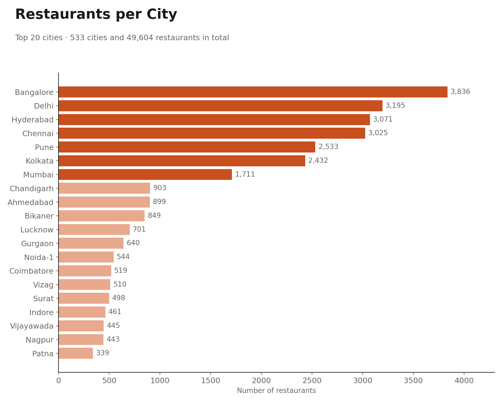
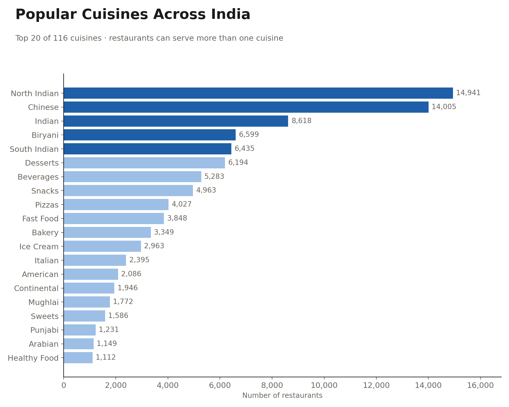
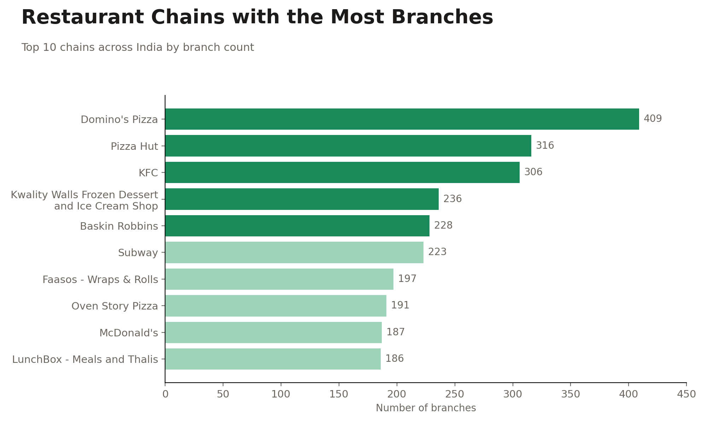
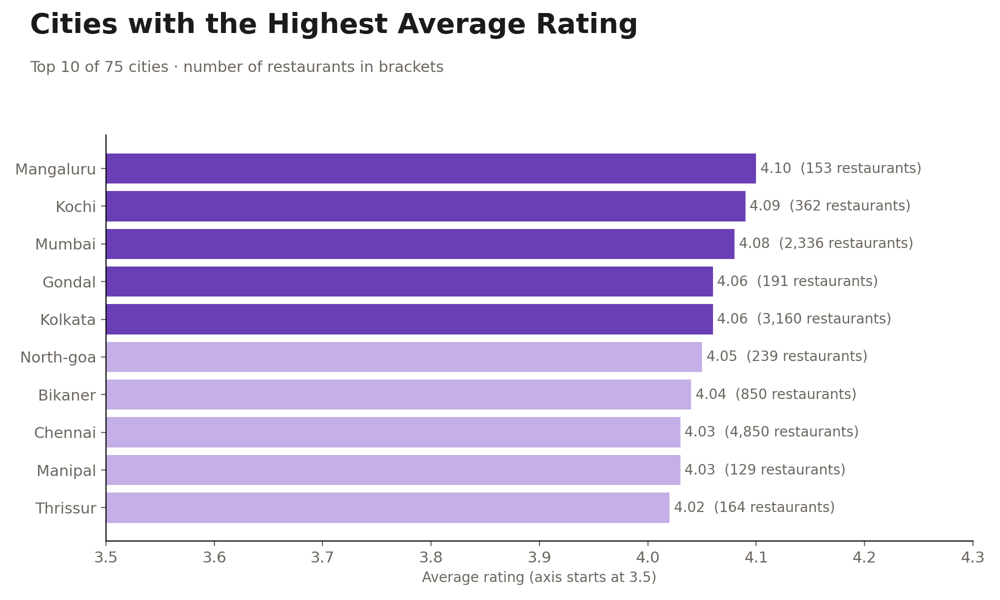
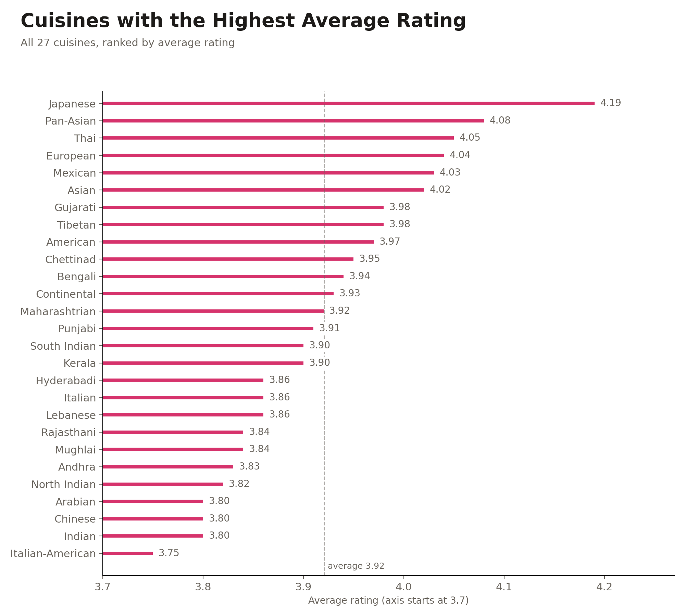
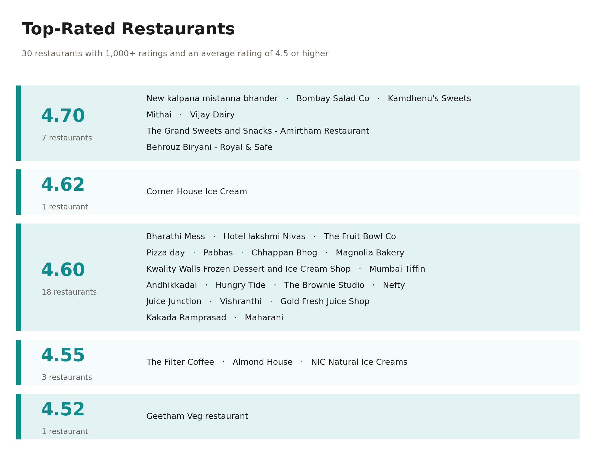

# Swiggy Dataset Analysis SQL

## 📌Project Overview
This SQL project analyses the popular Swiggy dataset to uncover key business insights related to restaurant distribution, cuisine popularity, customer ratings, and pricing. The project focuses on answering seven business questions using only SQL, from counting restaurants per city and finding the top chains to identifying the highest rated cuisines and the cities that offer the best value for money.

## 🗂️Dataset Highlights
- **Dataset:** Swiggy Restaurants Dataset
- **Columns Used:** ID, Restaurant name, City, Rating, Rating Count, Cost, Cuisine, License Number, Link, Address, Menu
- **Records:** More than 61,500 records

## 🔧Tasks Performed

### 🔍 Data Cleaning
- Removed restaurants with no usable rating
- Converted ratings from text into decimal values
- Handled missing values across key fields 
- Standardized numeric values (Rounded average_rating, average_cost)
- Standardized city names by extracting the main city from the location field using `SUBSTRING` function

### 🔄Data Transformation
- Created a `cost_num` column by stripping the currency symbol and non-digit characters from the cost field
- Split the multiple cuisines listed in a single field into one row per cuisine for each restaurant using `STRING_TO_ARRAY` and `UNNEST` within cuisine_rating_query
 
## 📊Business Questions Answered
### 1. Restaurants per city. 

🖥️ Query : [Restaurants per city](01_restaurants_per_city.sql)

**📈 Visualization:**

- The top 7 cities Bangalore (3,836), Delhi (3,195), Hyderabad (3,071), Chennai (3,025), Pune (2,533), Kolkata (2,432), Mumbai (1,711) hold about 40% of listings.
- The top 25 cities hold about 59% of restaurants.
- Mumbai is only 7th, which is surprising for India's largest food market.

### 2. Popular cuisines.

🖥️ Query : [Popular cuisines across India](02_popular_cuisines_across_india.sql)

**📈 Visualization:** 

- North Indian (14,941) and Chinese (14,005) are far ahead of everything else. They appear in roughly 30% and 28% of restaurants.
- Desserts, Beverages, Snacks and Pizzas all sit in the top 10, which shows how much of Swiggy is snacking and sweets, not just meals.
  
### 3. Chains with the most branches.

🖥️ Query : [Restaurant chains with most branches](03_restaurant_chains_with_most_branches.sql)

**📈 Visualization:** 

- Domino's (409), Pizza Hut (316) and KFC (306) lead.
- The top 25 chains account for about 4,700 branches, or about 9.5% of all listings. 
- Nine of the top 25 are ice cream or dessert brands (Kwality Walls, Baskin Robbins, NIC, Grameen Kulfi, Belgian Waffle and others).

### 4. Highest rated cities. 

🖥️ Query : [City with highest average rating](04_city_with_highest_average_rating.sql)

**📈 Visualization:** 

- The top 5 are Mangaluru (4.10), Kochi (4.09), Mumbai (4.08), Gondal (4.06) and Kolkata (4.06).
- Coastal South India stands out. Mangaluru, Kochi, Manipal, Thrissur, Thiruvananthapuram and Goa all rank high.
- Size doesn't hurt ratings. Mumbai, Kolkata, Chennai and Bangalore all score 4.01 or above despite thousands of restaurants.

### 5. Highest rated cuisines.

🖥️ Query : [Highest rated cuisines](05_highest_average_rating.sql)

**📈 Visualization:** 

- Japanese is first at 4.19, followed by Pan Asian (4.08), Thai (4.05), European (4.04) and Mexican (4.03).
- Popularity and rating move in opposite directions. Chinese (3.80), Indian (3.80) and North Indian (3.82) are the most common cuisines but rank near the bottom.
- Regional Indian cuisines such as Gujarati (3.98), Chettinad (3.95) and Bengali (3.94) beat the generic "Indian" tag (3.80).

### 6. Rating above 4.5 with more than 1,000 ratings.

🖥️ Query : [Restaurants with rating above 4.5 with more than 1,000 ratings](06_restaurants_with_high_rating_and_count.sql)

**📈 Visualization:** 

- Only 30 restaurants qualify, roughly 0.06% of listings.
- About 12 of the 30 are sweet shops, ice cream or dessert brands (Kamdhenu's Sweets, Mithai, Corner House, Magnolia Bakery, NIC). Many others are regional South Indian places like Bharathi Mess and Hotel Lakshmi Nivas.
- Chain brands that appear in both this list and the chain list (Kwality Walls, NIC, Behrouz) show that scale and quality can coexist.

### 7. Value for money.

🖥️ Query :[Value for money](07_value_for_money.sql)

- No metro appears. Every city is a tier2 or tier3 city with an average cost of about ₹172 to ₹257.
- Gondal is the standout at 4.06 rating and ₹247. It is also the 4th highest rated city overall, so it is both great and cheap.
- 15 of the 31 cities are in South India (9 in Tamil Nadu, 4 in Kerala, 2 in Karnataka). Trichy, Madurai and Erode are at 3.99 to 4.00 for ₹230 to ₹251.
- Recommendation: tier2 South Indian and Gujarat cities offer metro level quality at about 30 to 40% lower cost, so they are good expansion or promotion targets.

### 🧠SQL Concepts Used
- Aggregate functions: `SUM()`, `COUNT()`, `AVG()`, `COUNT(DISTINCT )`
- Statistical function: `PERCENTILE_CONT` 
- String functions: `SUBSTRING`, `POSITION`, `TRIM`, `STRING_TO_ARRAY`
- Array functions: `UNNEST`, `STRING_TO_ARRAY`
- Numeric functions: `ROUND`, `NUMERIC` 
- Filtering: `WHERE`, `HAVING`, `NOT IN`, `LIKE`, `DISTINCT`
- CTE 
- Window functions
- `CASE` statements

### 🔗Dataset Source: 
- kaggle.com/datasets/ashishjangra27/swiggy-restaurants-dataset

